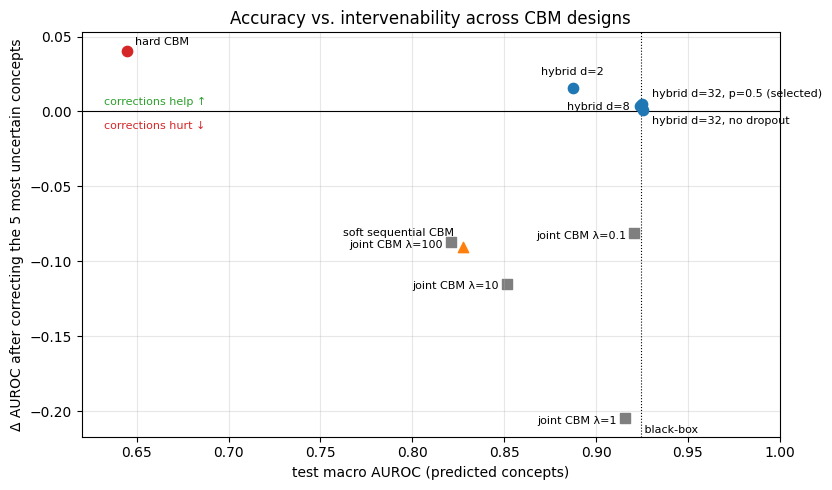

# When Concepts Leak: Concept Bottleneck Models for Interpretable ECG Diagnosis

Concept bottleneck models (CBMs) predict human-readable concepts first and the diagnosis second, so a clinician can inspect the concepts and correct a wrong one at test time. This project tests that promise on 12-lead ECG diagnosis with **PTB-XL** (21,388 records, 5 diagnostic superclasses), using 19 ECG form and rhythm statements as concepts.

**Main finding.** Soft CBMs reach good accuracy partly through *concept leakage*: diagnostic information hidden in the soft concept probabilities. As a result, correcting their concepts with annotated values makes them **worse**, not better. Two separable causes explain it: incomplete form annotations in PTB-XL and information carried by soft probabilities. A hard CBM restores intervenability but tops out near 0.70 AUROC; a hybrid with a residual channel and residual dropout matches the black box while keeping corrections beneficial, but its concepts then carry only 1–3% of the decision.

📄 **Report:** [link to the PDF report]

## Key results

Test fold (PTB-XL fold 10), macro AUROC over the 5 superclasses. Single-model means over seeds.

| Model | Test macro AUROC | Δ AUROC after correcting the 5 most uncertain concepts |
| --- | --- | --- |
| Black box (1D ResNet, 4.2 M params) | 0.924 ± 0.002 | — |
| CBM, independent | 0.819 | −0.074 |
| CBM, sequential | 0.827 | −0.090 |
| CBM, joint (λ = 1) | 0.915 | −0.199 |
| CBM, hard (binarized concepts) | 0.649 | **+0.040** |
| Hybrid CBM (hard concepts + residual, d = 32, p = 0.5) | **0.925** | **+0.005** (95% CI +0.003 to +0.007) |



Other findings:

- **Pre-registered prediction confirmed.** Written down before training: the CBM would lose most on conduction disturbances (CD), whose defining findings exist in PTB-XL only as diagnostic labels. The independent CBM loses 0.25 AUROC on CD.
- **Concept AUROC does not detect leakage.** A joint CBM with λ = 10 has concepts as faithful as a concept-only model (0.927 AUROC) yet still outperforms the sequential CBM, because the leaked information lives in the magnitude of the probabilities, not their ranking.
- **Annotation incompleteness is measurable.** Correcting form concepts on 707 non-annotated test records costs ten times more AUROC than on 707 annotated ones.

## Repository structure

```
.
├── notebooks/
│   ├── 01_data_and_concepts.ipynb        # labels, concept set, leakage exclusion, EDA (Fig. 1)
│   ├── 02_blackbox_baseline.ipynb        # 1D ResNet, random-crop ablation, 5 seeds
│   └── 03_cbm_and_interventions.ipynb    # CBM variants, interventions, leakage diagnosis,
│                                          # λ sweep, hybrid residual CBM
├── figures/                               # figures used in the report
├── results/                               # CSV tables exported by the notebooks
└── README.md
```

## Reproducing the results

All experiments run on **Kaggle Notebooks** with a single NVIDIA T4 GPU.

1. **Notebook 01** — add the dataset [PTB-XL v1.0.3](https://physionet.org/content/ptb-xl/1.0.3/) as input (on Kaggle: `ptb-xl-1.0.3`), enable Internet (for `wfdb`), accelerator *None*. Run all cells; outputs `X100.npy`, `labels.npz`, `concepts.csv`. ~10 min.
2. **Notebook 02** — add notebook 01's output as input, accelerator *GPU T4*. Trains the black box with and without random 2.5 s crops (5 seeds each). ~1 h.
3. **Notebook 03** — add the outputs of notebooks 01 and 02 and the PTB-XL dataset as inputs, accelerator *GPU T4*. Trains all CBM variants and runs the intervention experiments. ~2 h.

Protocol: official stratified folds (1–8 train, 9 validation, 10 test); per-lead standardization with training statistics only; model selection on validation only; 5 seeds for the main comparison (3 for the λ sweep and the hybrid grid); paired bootstrap (1,000 resamples) for model comparisons. Decision rules for random cropping and for the hybrid configuration were fixed before running the corresponding experiments.

Main dependencies: Python 3, PyTorch, NumPy, pandas, scikit-learn, matplotlib, `wfdb`.

## Data

PTB-XL is distributed by PhysioNet under the Creative Commons Attribution 4.0 license. It is not included in this repository.

> Wagner, P., Strodthoff, N., Bousseljot, R.-D., et al. (2020). PTB-XL, a large publicly available electrocardiography dataset. *Scientific Data*, 7, 154.

## References

- Koh, P. W., et al. (2020). Concept bottleneck models. *ICML*.
- Mahinpei, A., et al. (2021). Promises and pitfalls of black-box concept learning models. *ICML Workshop on XAI*.
- Havasi, M., Parbhoo, S., & Doshi-Velez, F. (2022). Addressing leakage in concept bottleneck models. *NeurIPS*.
- Marcinkevičs, R., Laguna, S., Vandenhirtz, M., & Vogt, J. E. (2024). Beyond concept bottleneck models: How to make black boxes intervenable? *NeurIPS*.
- Strodthoff, N., et al. (2021). Deep learning for ECG analysis: Benchmarks and insights from PTB-XL. *IEEE JBHI*.

## Author

Antonio Ramón Boza León ·  · arbozaleon@gmail.com
